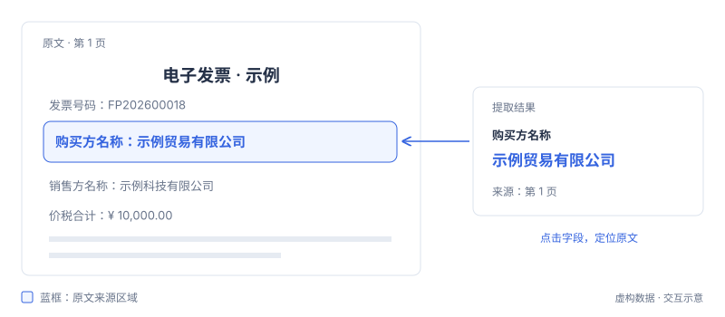

# 结果核验与导出

核验字段取值及原文依据，确认后导出。机器提取状态与业务审核结论分别记录。

## 原文定位

点击结果字段，查看来源页码和高亮区域。通过翻页、缩放检查字段是否对应正确的角色、金额或条款。

明细单元格或跨段条款可能包含多处依据，应逐项核对。

## 结果状态

- **待核验**：已提取，等待人工核对。
- **已确认**：人工已确认当前值。
- **已修改**：已保存人工核定值，保留机器原始值。
- **依据待核对**：引用或位置需进一步检查。
- **待图像核验**：印章、签名等内容需检查原始图像。
- **未找到**：未取得符合要求的内容，不代表业务上一定不存在。

## 确认与修改

取值与依据一致时点击“确认”。需要修正时点击“修改”，输入核定值并保存。原始值和原文依据继续保留。

“确认剩余项”批量确认已核对的待核验字段。依据待核对、待图像核验和未找到项保留原状态。

## 结果导出

点击“导出”选择格式：

- **CSV**：适合使用 Excel 查看和整理字段。
- **JSON**：适合程序处理结构化字段与来源依据。

导出内容保留核定值、原始值和核验状态。未核验字段按原状态导出。

“全文”标签提供 Markdown 预览、源码、复制和下载。需要配套图片时，选择“Markdown 与图片（.zip）”。

## 历史记录

关闭结果工作区后，字段、全文、配套图片和人工核验状态保存至历史记录，首页附件与输入清空。关闭帮助或切换页面不会结束任务。

历史记录汇总个人文档解析任务，按文件名搜索，或筛选处理中、待核验和失败记录。打开已完成材料可查看原文与全文、继续核验和导出，不会重新识别文档。

Studio API 调用在对应服务或场景的“运行记录”中查看。运行看板展示汇总指标，不计入个人历史列表。
