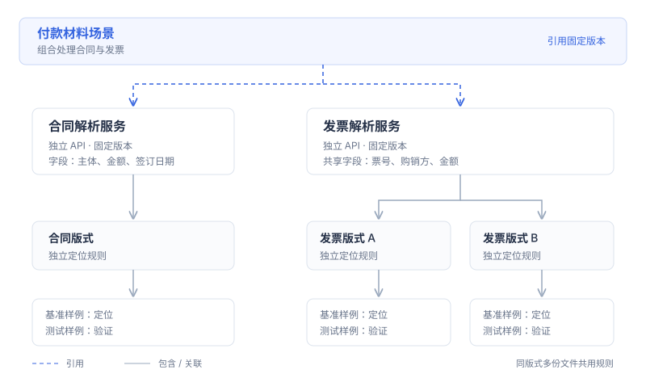

# 核心概念

文析用于交互式提取，Studio 用于开发可复用的提取服务。

## 使用方式

**文析**：上传材料，通过自然语言或字段表指定要求，核验结果后导出。适用于临时任务、变化较多的材料和语义提取需求。

**文析 Studio**：配置已知版式的规则，测试后发布 API。适用于嵌入业务流程、固定输入范围和稳定输出字段的需求。

## 服务与场景

**服务**承载一类材料的提取能力，可独立提供 API。**场景**引用多项服务的固定版本，设置材料约束并汇总处理结果。

例如，对外付款场景引用合同服务和发票服务。其他项目可单独复用发票服务，也可复制其配置后修改。

## 版式与样例

**版式**是一组稳定的布局、标签和定位规则。一个服务可支持多种版式，字段定义共用，定位规则分别配置。

**样例**是具体材料文件。相同版式、取值不同的文件共用规则；用于定位的文件为基准样例，其余文件用于测试。

## 公共能力

**公共服务库**提供已公开的服务版本，支持引用或复制修改。

**Skill 库**维护业务语义规则草稿，例如付款条件的含义、购销方角色的区分；当前支持编辑、复制及下载规则，尚未参与自动提取。

**能力组件**是 OCR、方向检测、预处理等公共能力的目录。目录展示可用状态和处理边界，实际使用策略在 Studio 的具体服务中配置。

测试和版本发布统一在 Studio 的对应服务内完成。**运行看板**汇总已保存的通用解析、服务接口和场景接口调用；内部识别不重复计数。分段耗时仅显示实际采集的记录。

**应用接入**整理调用方、拟申请的服务范围和日调用限额。当前保存为浏览器草稿，尚未执行真实授权、凭证签发或限流。

## 配置与运行

配置助手在开发阶段生成规则建议。规则经人工校准、测试和发布后，固定版本接口执行 OCR、版式匹配和规则取值，运行时不调用配置助手。

未知版式及复杂语义要求需单独验证，不属于固定规则服务的默认支持范围。
