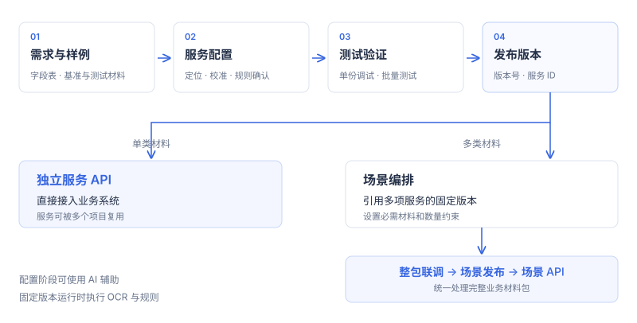

# 项目接入流程

以企业对外付款材料解析为例：合同和发票提取约定字段后，由业务后端执行数据库比对和审核。

## 开发流程

单类材料可独立开发服务并调用 API；多类材料通过场景组合已有服务。

## 需求准备

确认材料类别、已知版式、输出字段、材料数量约束和响应时间要求。准备 Excel 字段表，以及各版式的基准样例和独立测试样例。

多类材料按工作表分别定义字段，例如合同、发票和报关单。准备规范见[需求与样例](requirements.md)。

## 服务复用与创建

在“公共服务库”检查已有能力。字段和版式符合要求时引用固定版本；需要调整时复制为自己的服务。无适用服务时，在“我的服务”新建。

多类材料项目可进入“我的场景 → 新建场景”，使用默认的“AI 辅助创建”，提交需求、字段表和样例包，检查拆分建议后生成场景及服务草稿。需求示例：

> 企业对外付款材料解析。合同和发票必须提供，报关单可选，发票允许多份。字段要求分别位于 Excel 的合同、发票、报关单工作表中。相同版式共用规则，不同版式分别配置。

确认材料归组和字段要求后，点击“确认并生成定位草稿”。未定位字段进入人工校准。

## 规则配置与校准

进入服务“提取配置”，左侧选择版式，中间查看原文，右侧编辑规则或使用配置助手。

核对每个字段的样例取值、来源位置、类型和必填属性。位置错误时点击“调整定位”，在原文选取文字或框选区域；核对后点击“确认此字段”。同一服务的其他版式分别校准位置。

详细操作见[服务配置](services.md)。

## 测试与发布

1. 在配置页“试提取”中检查基准样例。
2. 在“单份调试”中上传新材料验证。
3. 在“批量测试”中添加样例并运行规则回放。
4. 点击“发布”，按发布检查的“去处理”补齐缺项。
5. 检查通过后确认发布，记录服务 ID 和版本号。

完整接口耗时需使用新文件调用验证；规则回放不包含上传与重新 OCR。见[测试与发布](testing.md)。

## 多材料场景联调

多类材料项目在场景中引用各服务的固定版本，设置必需项和多份约束。使用一笔完整材料或 ZIP 执行“整包联调”，检查缺失、歧义、失败项及字段依据。

联调通过后发布场景版本，取得整包调用接口。服务仍可独立复用。见[场景编排](scenes.md)。

## 业务系统接入

从“接口与版本”复制调用示例。业务后端上传材料并指定版本，检查解析状态，再执行数据库比对和审核；前端展示状态、结果和异常提示。

进入“运行记录”检查实际调用及总耗时。接口规范见[API 接入](api.md)。

## 交付内容

- 支持的材料、版式和字段定义。
- 接口地址、服务或场景 ID、固定版本。
- 新材料测试、批量回放和整包联调结果。
- 实际接口耗时及异常处理方案。
- 版本升级、回退与复测方法。

生产部署需补充访问控制、并发容量和监控配置。
